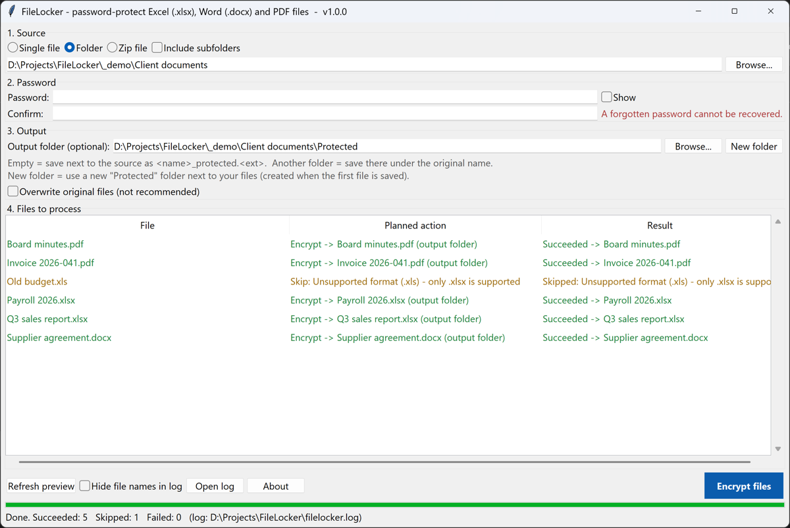

# FileLocker

A small, portable Windows tool that password-protects **Excel (.xlsx)**, **Word (.docx)**
and **PDF** files, one by one, in a folder, or inside a zip.



- Runs with **no installation and no admin rights**: just a folder you copy over.
- **Fully offline.** It has no networking code, switches off networking for its own
  process when it starts, and leaves web/SSL modules out of the exe. See
  [SECURITY.md](SECURITY.md).
- The password is **never stored, logged or printed**. It stays in memory only while
  files are being processed, and the form is cleared afterwards.
- **Open source and verifiable.** Releases are built by GitHub Actions from tagged source.
  Each comes with SHA-256 checksums, a signed build attestation, an SBOM and a self-test
  report. See [VERIFYING.md](VERIFYING.md).

> **Warning: a forgotten password cannot be recovered.**
> Excel and Word files are encrypted with ECMA-376 Agile encryption, AES-256 (the same as
> Office's own *Encrypt with Password*). PDFs are encrypted with AES-256. Without the password
> the content is unreadable, and neither this tool nor anyone else can open it.
> Keep the password somewhere safe, and keep backups of important originals.

**Contents:** [Using FileLocker](#using-filelocker) · [Zip files](#zip-files) ·
[Getting FileLocker](#getting-filelocker) · [Building from source](#building-from-source) ·
[Development](#development) · [Security](SECURITY.md) · [Verifying a release](VERIFYING.md)

---

## Using FileLocker

1. **Source:** choose *Single file*, *Folder* or *Zip file*, then click **Browse...**. For a
   folder, tick **Include subfolders** to scan the whole tree.
2. **Password:** type it twice. Both entries must match and can't be empty. Tick **Show** to
   check what you typed. If the password is shorter than 10 characters, FileLocker warns you
   and asks you to confirm.
3. **Output (optional):** pick an output folder. If you leave it empty, each new file is
   written next to its source. When you process a folder with subfolders into an output
   folder, the subfolder structure is recreated there.
   Click **New folder** to use a new `Protected` folder next to your files: inside the
   chosen folder, or beside the chosen file or zip. If `Protected` already exists, it picks
   `Protected (2)`, `(3)`, and so on. The folder is only created when the first file is saved.
   Files already inside the output folder are never picked up as input.
4. **Preview:** the list shows every file that was found, what will happen to it, and the
   exact name its protected copy will get.
5. Click **Encrypt files**. Your original is **not changed**. The protected copy is named
   like this:

   | Where it is saved | Name of the protected copy | If that name is taken |
   |---|---|---|
   | Same folder as the original (output folder empty, or set to the same folder) | `<name>_protected.<ext>` | `<name>_protected(2).<ext>`, `(3)`, ... |
   | A different output folder | `<name>.<ext>` (the original name) | `<name>(2).<ext>`, `(3)`, ... |

   An existing file is never overwritten.

   While it runs, the button turns into a red **Stop** button. Stopping finishes the file
   in progress (no half-written files), then skips the rest. In zip mode, stopping means no
   new zip is created.
6. When the run finishes, every row shows its result, and a summary dialog appears.

**Overwrite original files** is off by default. If you turn it on, FileLocker asks you to
confirm, and then replaces each original with its encrypted version. The encrypted version
is written and verified first, and only then swapped in, so a failure never damages the
original.

**About** shows the version, the source commit it was built from, and whether the network
guard is active.

### Zip files

Choose **Zip file** when a client sends a zip. FileLocker:

1. extracts the zip to a private temporary folder
2. password-protects every `.xlsx`, `.docx` and `.pdf` inside it **individually**. The zip
   itself does **not** get a password.
3. zips everything again, with the same folders and file names, and checks the new zip
4. deletes the temporary extracted copies, even if something went wrong

The new zip follows the same naming rule as single files. Next to the original it's saved
as `<name>_protected.zip`. In a different output folder it keeps the original name.
**Overwrite original files** replaces the original zip.

| File inside the zip | What happens |
|---|---|
| `.xlsx`, `.docx`, `.pdf` | Password-protected |
| Other files (`.txt`, images, `.xls`, `.doc`, ...) | Put in the new zip unchanged and listed as **NOT protected** |
| Already password-protected document | Put in the new zip unchanged (it keeps its existing password) |
| macOS metadata (`__MACOSX/`, `._name`) | Put in the new zip unchanged |

Safety rules:
- **If any document fails to be protected, no zip is created**, so a zip never silently
  contains an unprotected copy. The summary shows which file failed and why.
- Before the new zip gets its final name, FileLocker checks that every file inside it is
  byte-for-byte the copy that was already verified with the password.
- **Rejected zips:** password-protected zips, and zips with unsafe paths (`../`, absolute
  paths), names Windows can't use or duplicate names. FileLocker also rejects zips that need
  more free disk space than is available.
- **Garbled file names:** names from zip tools that store UTF-8 without marking it are
  repaired, so names like `Résumé.pdf` come out correctly.
- **"Compression method can't be read":** some very large zips made by Windows use
  *Deflate64*. Extract the zip, zip it again, and retry.

### What gets skipped or fails, and why

| Situation | Result |
|---|---|
| File is already password-protected or encrypted | Skipped |
| `.xls`, `.xlsm` or `.doc` | Skipped: unsupported (only `.xlsx` and `.docx` are supported) |
| `~$name.xlsx` / `~$name.docx` (Office's temporary lock files) | Skipped |
| File is open in another program, or access is denied | Failed: reported, and the run continues |
| Corrupt or not a real xlsx/docx/pdf | Failed |
| The encrypted output did not re-open correctly with the password | Failed: the bad output is deleted |

Every output is checked before it is reported as a success. FileLocker re-opens the output
and decrypts it in memory with the password. For Excel and Word, it also checks that the
document structure is intact. For PDF, it checks the page count, and it confirms that the
file will **not** open without a password.

### Why .xls and .doc are not supported

The old binary Office formats (`.xls`, `.doc`) can't be encrypted with the offline library
this tool uses: it can only *decrypt* them. They also only support Office's weak legacy RC4
encryption. To protect such a file, open it in Excel or Word, use **Save As** to save it as
`.xlsx` or `.docx`, then protect the new file with FileLocker.

### Log file

Each action and result (file paths, outcome and reason, **never the password**) is written to
`filelocker.log` next to `FileLocker.exe`. If that folder is read-only, the log goes to
`%LOCALAPPDATA%\FileLocker\filelocker.log` instead. Click **Open log** in the app to view it.

Tick **Hide file names in log** to replace file and folder names with a short fingerprint.
The log then still shows what happened, but not which files were involved.

---

## Getting FileLocker

### Option A (recommended): official release

1. Download `FileLocker-<version>-win64.zip` and `SHA256SUMS.txt` from this repository's
   **Releases** page.
2. Optionally verify it. [VERIFYING.md](VERIFYING.md) explains how, in five minutes.
3. Right-click the zip, choose **Properties**, tick **Unblock**, then **Extract All**. Use a
   short path you can write to, such as `C:\Users\<you>\Tools\FileLocker`.
4. Run `FileLocker.exe`. Keep the whole folder together: the exe needs its `_internal`
   folder.

> **Use a short folder path.** If the full path is very long (roughly 150+ characters),
> Windows can fail to load the bundled DLLs, and you'll see *"The filename or extension is
> too long"*.

The exe is not code-signed. On first start SmartScreen may show *"Windows protected your PC"*.
Choose **More info → Run anyway**, or have IT allow it (see [VERIFYING.md](VERIFYING.md)).

There is **no auto-update** on purpose: FileLocker never contacts anything. New versions
reach users only when someone (normally IT) deploys them.

### Option B (fallback): portable Python + `run_portable.bat`

This runs the Python source directly with the official, no-install **Windows embeddable
package** of Python. Prepare it on a normal PC, then copy the whole folder over.

1. Download the **"Windows embeddable package (64-bit)"** for **Python 3.14** from
   <https://www.python.org/downloads/windows/>.
2. Extract it into a subfolder named **`python`** inside the `FileLocker` source folder, so
   that `FileLocker\python\python.exe` exists.
3. **Enable site-packages:** open `FileLocker\python\python314._pth` in Notepad and make it
   look like this:
   ```
   python314.zip
   .
   Lib
   Lib\site-packages
   import site
   ```
4. **Add tkinter**, which the embeddable package does not include. Copy these from a normal
   Python 3.14 64-bit install, for example
   `C:\Users\<you>\AppData\Local\Programs\Python\Python314\`:

   | Copy from the normal install | To |
   |---|---|
   | `Lib\tkinter\` (whole folder) | `FileLocker\python\Lib\tkinter\` |
   | `DLLs\_tkinter.pyd` | `FileLocker\python\` |
   | `DLLs\tcl86t.dll` and `DLLs\tk86t.dll` (the `tcl*.dll` / `tk*.dll` files) | `FileLocker\python\` |
   | `tcl\` (whole folder) | `FileLocker\python\tcl\` |

5. **Install the pinned, hash-verified libraries into it** (from inside the `FileLocker`
   folder, using the normal Python 3.14):
   ```bat
   py -3.14 -m pip install --require-hashes --no-deps --target python\Lib\site-packages -r requirements.txt
   ```
6. Test it: double-click **`run_portable.bat`**. If anything is missing, it shows which import
   failed.
7. Copy the whole `FileLocker` folder, including the `python` subfolder, to the target
   computer and launch it with `run_portable.bat`.

---

## Building from source

Official releases are built by GitHub Actions (`.github/workflows/release.yml`). To build
the same thing yourself on a Windows PC with **Python 3.14** and internet access:

```bat
build.bat
```

`build.bat` creates `.venv` and installs every dependency **pinned to an exact version and
verified by SHA-256 hash** (`requirements*.txt`). It then runs all tests and calls
`scripts\build.py`, which:

1. records the version and git commit in the exe (*About* box and the file's Properties)
2. runs PyInstaller (`--onedir --windowed`), excluding network and web modules
3. adds this README, the LICENSE, SECURITY, VERIFYING, CHANGELOG and THIRD_PARTY_LICENSES
4. runs the built exe's self-test (`FileLocker.exe --selftest`) and stops if it fails
5. writes `release\FileLocker-<version>-win64.zip` and `release\SHA256SUMS.txt`

`--onedir` is deliberate. Single-file (`--onefile`) exes unpack themselves into a temp folder
at every start, and antivirus tools often flag that behaviour.

### Making a release

1. Update `__version__` in `version.py` and add an entry to `CHANGELOG.md`.
2. Commit, then tag and push: `git tag v1.0.1` and `git push origin v1.0.1`.
3. The **Release** workflow tests, scans, builds, self-tests and attests the build, then
   creates a **draft** GitHub release.
4. Review the draft (download it and run the self-test), then click **Publish**.

---

## Development

```bat
py -3.14 -m venv .venv
.venv\Scripts\python -m pip install --require-hashes --no-deps -r requirements.txt -r requirements-build.txt -r requirements-test.txt
.venv\Scripts\python tests\test_crypto.py
.venv\Scripts\python tests\test_no_network.py
.venv\Scripts\python main.py
.venv\Scripts\python main.py --selftest report.txt
```

`openpyxl` (in `requirements-test.txt`) is only used by the tests. It is not part of the app.

### Updating dependencies

Direct dependencies are listed in `requirements.in`, `requirements-build.in` and
`requirements-test.in`. The `.txt` files are generated lock files with hashes, so don't edit
them by hand:

```bat
.venv\Scripts\python -m pip install pip-tools
.venv\Scripts\python -m piptools compile --generate-hashes --allow-unsafe --strip-extras --no-emit-index-url --output-file=requirements.txt requirements.in
```

Do the same for `-build` and `-test`. Updates are manual (there is no automatic updater), and every update
must pass CI (tests, `pip-audit`, `bandit`, exe self-test) before it is merged.

### Project layout

```
FileLocker/
├── main.py             entry point; installs the network guard first
├── netguard.py         network kill switch (blocks sockets/DNS for the whole process)
├── gui.py              tkinter UI (work runs in a background thread)
├── processor.py        encrypt -> verify -> move into place; skip/fail rules; naming
├── zip_processor.py    zip mode: safe extract -> protect each file -> re-zip -> verify
├── scanner.py          finds .xlsx/.docx/.pdf files (flags .xls/.xlsm/.doc as unsupported)
├── office_crypto.py    .xlsx/.docx encryption (msoffcrypto-tool, ECMA-376 Agile AES-256)
├── pdf_crypto.py       .pdf encryption (pypdf, AES-256, same user & owner password)
├── logger.py           filelocker.log (never the password; optional name hiding)
├── selftest.py         FileLocker.exe --selftest
├── version.py          version number
├── requirements*.in    direct dependencies
├── requirements*.txt   hash-pinned lock files (generated by pip-tools)
├── build.bat           local build (same steps as CI)
├── scripts/build.py    PyInstaller build, docs, self-test, zip, checksums
├── run_portable.bat    fallback launcher using .\python\ (embeddable Python)
├── tests/              test_crypto.py, test_no_network.py
├── .github/            CI and release workflows
├── SECURITY.md  VERIFYING.md  CHANGELOG.md  LICENSE
└── README.md
```

## License

MIT, see [LICENSE](LICENSE). Bundled third-party components and their licenses are listed in
`THIRD_PARTY_LICENSES.txt` inside every release.
